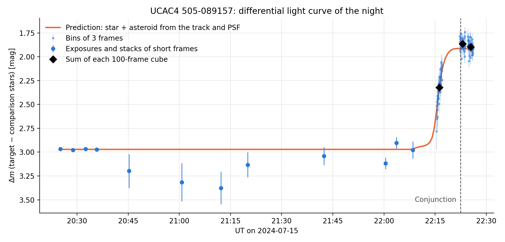

# Occultation of UCAC4 505-089157 by (754) Malabar

Data reduction and differential photometry of observations taken on 2024-07-15 with the 1.5 m telescope and the PICO camera at the Leopold Figl Observatory.

## Result

No occultation dip is detected at the observatory.

- **Conjunction:** Malabar passes the star at 22:22:29 ± 4 s UT, measured from the images. The prediction for the site from the OccultWatcher path elements, calibrated with the published chords, is 22:22:25 UT.
- **Expected signal:** the blended flux of star and asteroid should drop by 37 % (0.49 mag).
- **Search:** a 7 s dip deeper than 18 % would be detected at 5σ. Shorter events of 1 to 3 frames reach at most −1.8σ near the predicted time, against −3.9σ to −6.7σ expected.
- **Geometry:** the observatory lies about 2 to 3 km south of the shadow limit fitted to the eight published chords, so this is most likely a near miss. The observatory coordinates used for this (48.083° N, 15.924° E) have not been checked against a source. The path comparison is not part of the notebooks.

The exposures cover 0.3 s of each 1.01 s cycle, so a graze shorter than about 1 s cannot be fully excluded. `MJD-OBS` has a resolution of 1 s.

## Files

| File | Content |
| --- | --- |
| `data reduction.ipynb` | Master bias, dark and flat, bad pixel mask, corrected science frames |
| `stacking and light curve.ipynb` | Alignment, background, stacking, photometry, asteroid track, dip search |
| `source detection.ipynb` | Earlier exploration of source detection |
| `photometry.py` | Helper functions for the light curve notebook |
| `gaia_field.csv` | Gaia DR3 catalogue of the field, for offline use |
| `lightcurve.csv` | The differential light curve |
| `lightcurve_night.png`, `lightcurve_event_cubes.png`, `occultation_search.png` | Figures |

## Running the notebooks

The FITS data are not in this repository because of their size. The notebooks expect the raw frames in `20240715/`, and write to `20240715_reduced/`. Run `data reduction.ipynb` first, then `stacking and light curve.ipynb`.

Requirements: `numpy`, `scipy`, `matplotlib`, `astropy`, `photutils`, `scikit-image`.
